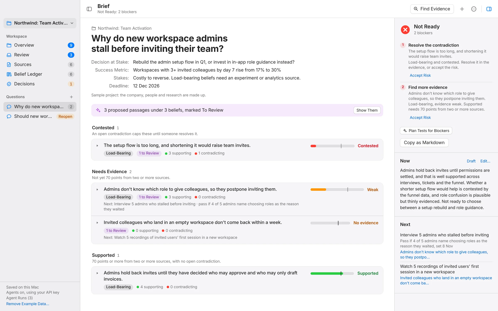

# TraceFox for Mac

**Every product decision can show its evidence.**

TraceFox is a free Mac app for product teams. You write down the decision you are facing and the beliefs it rests on, add your research, and TraceFox shows which beliefs are backed by evidence, which are contested, and what is still missing before you can decide.

[**Free download for Mac**](https://github.com/JayKrech/tracefox-mac/releases/latest/download/TraceFox.dmg) · [tracefox.app](https://tracefox.app)



## What it does

- **Questions and beliefs.** Each decision is a question with the beliefs that have to be true for it to work.
- **Evidence with sources.** Every piece of evidence is a word-for-word quote from one of your sources: interviews, surveys, analytics, experiments. If the quote disappears from the source, TraceFox flags it.
- **Honest confidence.** A belief is Supported, Contested or Needs Evidence. One loud interview is not enough: support has to come from more than one source.
- **Blockers before sign-off.** TraceFox lists what stands between you and a decision you can defend.
- **Decision records.** When you sign off, TraceFox keeps what you chose, why, and which beliefs to watch. If one of them changes, the decision is marked for review.
- **Agents that propose, never decide.** They draft beliefs, find quotes in your sources, summarise, and suggest test plans. You accept or reject everything. Sources that contain instructions aimed at an AI are flagged.
- **Projects.** Group questions, sources and context files per project.

## Install

1. Download [TraceFox.dmg](https://github.com/JayKrech/tracefox-mac/releases/latest/download/TraceFox.dmg).
2. Open it and drag TraceFox into Applications.
3. Open TraceFox. Choose **TraceFox › Settings…** (⌘,) and paste an Anthropic API key. You can create one at <https://console.anthropic.com/settings/keys>.

Requires macOS 12 or later, on Apple silicon or Intel.

TraceFox is free. The agents run on your own Anthropic API key, so Anthropic charges you for what they use. Everything else works without a key.

## Privacy

- **Your workspace stays on your Mac**, in `~/Library/Application Support/TraceFox/workspace.json`. File › Show Data in Finder opens the folder. A copy for each of the last 7 days you used it is kept in `backups` next to it.
- **Your API key is encrypted with the macOS Keychain** and stored next to the workspace.
- **The app only talks to `api.anthropic.com`**, and only when you run an agent or check your key. An agent run sends the question, its beliefs, and the sources and context files that agent needs. TraceFox tells you this once, before the first run.
- **No account, no analytics, no tracking, no update checks.** TraceFox › Check for Updates… opens the releases page in your browser.

The pages of the app have no network access at all, and text from sources or agents can never run as code. [SECURITY.md](SECURITY.md) describes how this is enforced and what the limits are. The code in this repository is the whole app, so you can check all of this yourself.

## Build it yourself

You need a Mac and Node.js 22.12 or later.

```sh
npm install
npm start
```

To build a disk image for your own Mac:

```sh
npm run dmg
```

It is signed ad hoc: it opens on your Mac, and other Macs ask for permission once under System Settings › Privacy & Security.

How the official download is built, signed and notarized is described in [docs/RELEASING.md](docs/RELEASING.md).

## What's inside

| File | Purpose |
|---|---|
| `main.js` | App window, menus, Settings window, workspace storage, agent requests |
| `ai.js` | Anthropic Messages API client: JSON-only replies, error mapping, key check |
| `preload.js` | The bridge the page uses for storage, agents and menu commands |
| `settings.html` | Settings: API key, model, data folder |
| `app/index.html` | The TraceFox interface, built as one page |
| `build/` | App icon, Info.plist additions, hardened-runtime entitlements |
| `scripts/` | Packaging, the test disk image, the signed release, the pages' security policy |

## Tests

```sh
npm test
```

This runs the unit tests for the API client and checks the pages' security policy. `npm run test:e2e` launches the real app and drives it with a stand-in for the agents, then runs the injection test: it fills every field and every agent reply with hostile markup and checks that none of it is rendered. Both need [Playwright](https://playwright.dev) (`npm install --no-save playwright`) but no key and no network, and on Linux the first runs under `xvfb-run`.

Every build also starts the packaged app once with `--self-test`, which checks that the page loads, storage works and the network is blocked.

## Feedback

Found a bug or missing something? [Open an issue](https://github.com/JayKrech/tracefox-mac/issues).

## Licence

Copyright 2026 Jakob Ehe. TraceFox is published under the [Functional Source License, Version 1.1, MIT Future License](LICENSE.md). In short: you may use, read, change and share it for free, including at work, but you may not offer it or something built from it as a competing product. Each version becomes available under the MIT licence two years after its release. The licence text is what counts, not this summary.

The app icon uses the Noto Emoji fox (Apache License 2.0, Google), taken from the svgmoji package (MIT, see `build/LICENSE-svgmoji.txt`).
